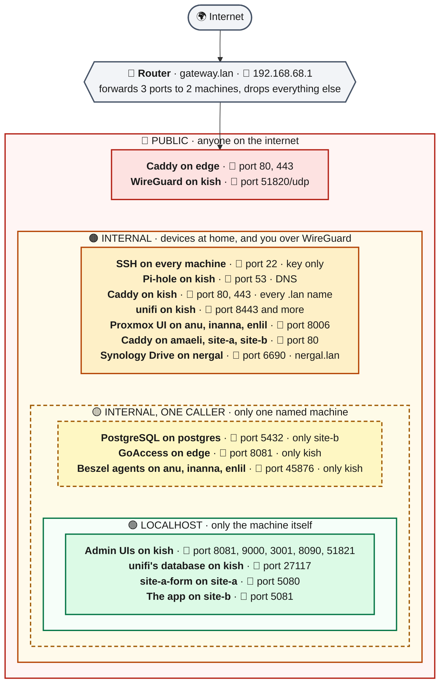
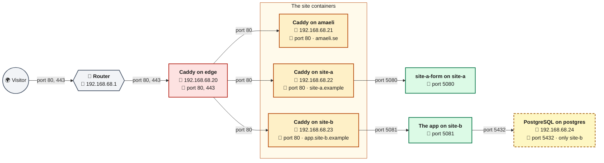
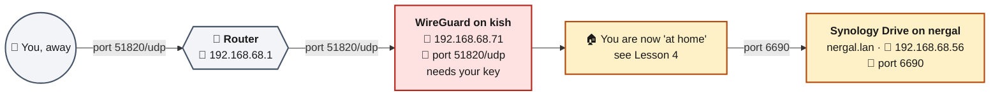
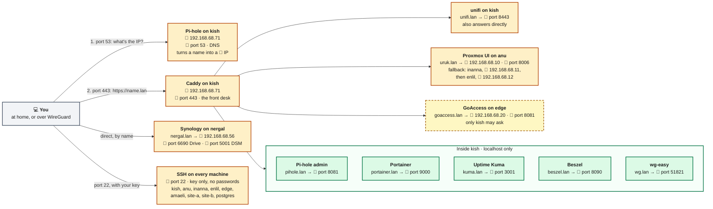
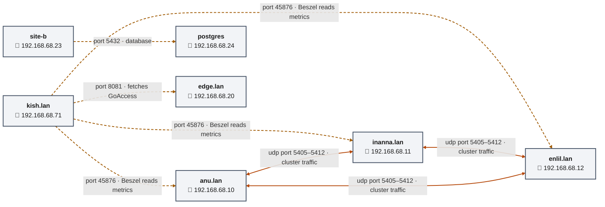

# Network cheat sheet

Every port in the lab, and who is allowed to knock on it. Details in
[network.md](network.md).

## How to read the labels

| Looks like | Means | Example |
|---|---|---|
| 📍 `192.168.68.71` | An **IP address**: *which machine*. Always written in full | kish is 📍 `192.168.68.71` |
| 🔌 port `53` | A **port**: *which door* on that machine | Pi-hole answers on 🔌 port `53` |
| **Program on machine** | The first line of a box: *what* is running *where* | **Pi-hole on kish** |

An IP and a port together name one exact door: 📍 `192.168.68.71` + 🔌 port
`53` is often written `192.168.68.71:53`.

## The colours

| Colour | Ring | Who can knock |
|---|---|---|
| 🔴 red | **Public** | Anyone on the internet |
| 🟠 orange | **Internal** | Any device at home, and you over WireGuard |
| 🟡 yellow, dashed | **Internal, one caller** | One named machine only; everyone else is refused |
| 🟢 green | **Localhost** | Only the machine itself. You reach these through Caddy |

## Lesson 1: the rings

The deeper the ring, the fewer can knock. **The router is the only door** from
the internet: a port is public only if the router forwards it.



## Lesson 2: a visitor opens one of your websites

The only traffic that starts on the internet. It enters at one red door and
moves **inward**, one ring at a time.



Red → orange → green → yellow: the visitor only ever talks to `edge`. `edge`
talks to the containers, and each container talks to its own app. amaeli is a
static site: its Caddy serves the files itself, so there is no app behind it.

## Lesson 3: the other door, WireGuard



Your files are behind WireGuard too. Until 2026-09-30 the NAS had two doors of
its own: port 6690 forwarded to Synology Drive, and QuickConnect through
Synology's relay. Both answered anyone and asked for a login, so both were
closed: away from home, Drive now syncs over WireGuard
([ADR 0013](decisions/0013-nas-reached-only-from-home-or-wireguard.md)).

## Lesson 4: you, managing the lab from home

Everything starts on the orange ring: your Mac or desktop at home, or your phone
over WireGuard. **Caddy on kish is the front desk**: you ask for a `.lan` name,
and it walks you to the right port.



## Lesson 5: machines talking to machines

Nobody starts these; the machines do it on their own, all the time.



- **Dashed yellow lines** are one-caller ports: 45876, 8081 and 5432 refuse
  everyone else.
- **Solid orange lines** are open to the whole LAN.
- **The cluster vote:** anu, inanna and enlil have one vote each, and two make
  a majority. When one node is down, the other two keep the cluster running
  ([ADR 0014](decisions/0014-three-nodes-no-qdevice.md); until 2026-10-12 a
  QDevice on kish was the third vote for two nodes).

## Lesson 6: real-world scenarios, knocking from outside

Tested on 2026-09-29 from the Mac, away from home, with WireGuard off: exactly
what a stranger on the internet sees. `203.0.113.10` is the home's public
📍 IP.

```bash
# Mac, away from home, WireGuard off
nc -vz -G 5 203.0.113.10 80
nc -vz -G 5 203.0.113.10 443
nc -vz -G 5 203.0.113.10 6690
```

`-G 5` gives up after 5 seconds. Without it, macOS `nc` can wait over a minute
before reporting a closed port.

`nc` knocks on a port and reports whether anything answered. **`succeeded!`**
means the door is open; **a timeout** means the router dropped the knock
silently, which is what every other port should do.

### 🔌 Ports 80 and 443: your websites on edge

```text
Connection to 203.0.113.10 port 80 [tcp/http] succeeded!
Connection to 203.0.113.10 port 443 [tcp/https] succeeded!
```

- **Who it's for:** everyone. Websites are meant to be public, so there is
  no login on this door.
- **The guards, in layers:**
  1. **Caddy on edge.** It answers only for amaeli.se, site-a.example and
     app.site-b.example, and passes each to its container. Port 80 only
     redirects to 443. Caddy is mature and updates itself.
  2. **Each site's own code**, the real guard:
     - **amaeli:** static files only, so there's almost nothing to attack.
     - **site-a:** a static site plus `site-a-form`, which accepts the
       contact form.
     - **site-b:** a full app with logins and a database. The most code
       facing strangers.
  3. **Damage control if a site is broken into:** each app runs as its own
     unprivileged user, its secrets are readable only by that user, and
     postgres accepts only site-b.

### 🔌 Port 6690: closed since 2026-09-30

```text
Connection to 203.0.113.10 port 6690 [tcp/*] succeeded!                    # 2026-09-29
nc: connectx to 203.0.113.10 port 6690 (tcp) failed: Operation timed out  # 2026-09-30
```

- **What changed:** the 6690 forward was deleted, and QuickConnect and the
  DDNS name `nergal.synology.me` were turned off with it. The same knock now
  gets silence, like any closed port.
- **Why:** Synology Drive answered anyone and asked for a login, which made
  it the most likely way in of the four ports. WireGuard stays silent without
  your key.
- **What it costs:** away from home, Drive syncs only with WireGuard on.
  Otherwise it waits and catches up later; nothing is lost.

## Every port, machine by machine

The complete list. 🔴 public · 🟠 internal · 🟡 one caller · 🟢 localhost.

| Machine | 🔌 Ports on it |
|---|---|
| **router** · gateway.lan · 📍 `192.168.68.1` | forwards 🔴 80, 443 → edge · 🔴 51820/udp → kish |
| **kish** · kish.lan · 📍 `192.168.68.71` | 🔴 51820/udp WireGuard · 🟠 22 SSH (key only) · 🟠 53 Pi-hole DNS · 🟠 80, 443 Caddy · 🟠 unifi 8080, 8443, 8843, 8880, 6789, 28082, udp 3478, 10001, 5514 · 🟠 udp 5353 mDNS (avahi, unused) · 🟢 8081 Pi-hole admin · 🟢 9000 Portainer · 🟢 3001 Kuma · 🟢 8090 Beszel · 🟢 51821 wg-easy · 🟢 27117 unifi database |
| **anu** · anu.lan · 📍 `192.168.68.10` | 🟠 8006 Proxmox UI · 🟠 22 SSH (key only) · 🟠 3128 SPICE · 🟠 udp 5405–5412 cluster · 🟡 45876 Beszel, only kish |
| **inanna** · inanna.lan · 📍 `192.168.68.11` | 🟠 8006 Proxmox UI · 🟠 22 SSH (key only) · 🟠 3128 SPICE · 🟠 udp 5405–5412 cluster · 🟡 45876 Beszel, only kish |
| **enlil** · enlil.lan · 📍 `192.168.68.12` | 🟠 8006 Proxmox UI · 🟠 22 SSH (key only) · 🟠 3128 SPICE · 🟠 udp 5405–5412 cluster · 🟡 45876 Beszel, only kish |
| **edge** · edge.lan · 📍 `192.168.68.20` | 🔴 80, 443 Caddy · 🟠 22 SSH (key only) · 🟡 8081 GoAccess, only kish |
| **amaeli** · 📍 `192.168.68.21` | 🟠 80 Caddy · 🟠 22 SSH (key only) |
| **site-a** · 📍 `192.168.68.22` | 🟠 80 Caddy · 🟠 22 SSH (key only) · 🟢 5080 site-a-form |
| **site-b** · 📍 `192.168.68.23` | 🟠 80 Caddy · 🟠 22 SSH (key only) · 🟢 5081 app — avahi's 5353/udp removed 2026-10-13 |
| **postgres** · 📍 `192.168.68.24` | 🟡 5432 PostgreSQL, only site-b · 🟠 22 SSH (key only) |
| **nergal** · nergal.lan · 📍 `192.168.68.56` | 🟠 6690 Drive · 🟠 5000, 5001 DSM · 🟠 80, 443 redirect to DSM |
| **Hue bridge** · hue.lan · 📍 `192.168.68.66` | 🟠 80, 443 |

**Left out on purpose:** localhost ports nothing here uses — Caddy's admin API
(`127.0.0.1:2019`) on `edge` and the site containers, the local mail agent
(`127.0.0.1:25`) in the containers, `systemd-resolved`'s stub on `edge` — and
`edge`'s LLMNR (5355), which its guest firewall drops.

**Good to know:**
- **SSH (🔌 port 22) accepts keys only on every lab machine.** Confirmed on
  2026-09-29: with keys switched off, all eight answered `Permission denied
  (publickey)`. enlil, added 2026-10-12, was checked with `sshd -T`. Without your key, there is no way in over SSH.
- **Firewalls:** the Proxmox nodes (Datacenter level: the LAN in, the rest
  dropped), `edge`, and `nergal` since 2026-10-02, which turns away the
  Proxmox guests (`.20`–`.49`) and the Hue bridge (`.66`). The other guests
  have none (HL-86), so their orange ports are open to every device at home.
- **The network is flat.** Every device at home, the Hue bridge included, is on
  the orange ring.
- **The red doors were tested from outside** (Lesson 6): 80 and 443 answer
  (2026-09-29), 6690 times out since it was closed (2026-09-30). 51820/udp
  can't be knocked on with `nc`, because WireGuard stays silent to anyone
  without a key; it is tested by connecting. All of it re-checked from a phone
  hotspot on 2026-10-13: 80 and 443 open, 3389, 445, 5985, 5986, 5000, 5001
  and 6690 timed out, and the tunnel reached kish by IP and by name.

**Checked:** kish's ports live on 2026-09-28, and kish's and the five guests' on 2026-10-13 and 2026-10-17; SSH key-only on all eight lab
machines on 2026-09-29, and on enlil with `sshd -T` on 2026-10-12; `nergal`'s ports and firewall on 2026-10-02 (from the
Mac, `kish` and `edge`); the three nodes' ports and the Hue bridge's on
2026-10-17.
